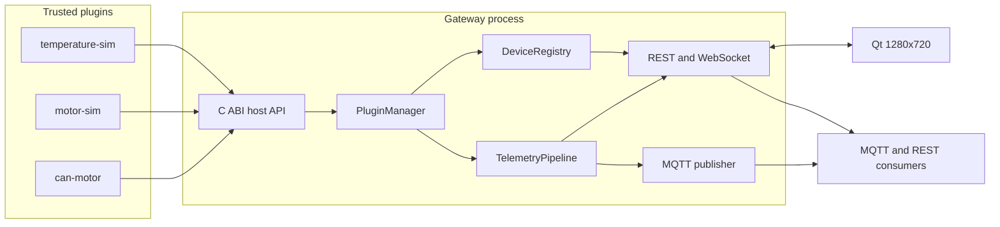

# Open Gateway — Implementation Plan

**Status:** Ready to implement  
**Source:** [PRD.md](PRD.md) and [PROJECT_BRIEF.md](PROJECT_BRIEF.md)  
**Scope of this plan:** Milestones M1–M6. The embedded-Linux image is not a milestone of this repository.

This plan freezes the open choices in PRD §11 so implementation can start. The gateway stays headless. The only UI is the Qt/QML application in `edge/display`, laid out for the Raspberry Pi Touch Display 2 at **1280×720** landscape. The window fills that display. Local `docker compose` opens that window as a desktop application on the developer machine. A Compose setting selects noVNC instead. Azure serves the same UI through noVNC. There is no React client.

A sensor list shows every available device and is where the user enables or disables one. The dashboard shows only enabled devices and their current values. A real sensor is enabled when its hardware is present and greyed out when it is not. Simulated sensors start disabled. Consumers fetch data over MQTT and REST. Both appear in the OpenAPI specification. A trusted `.so` can be activated while the gateway is running.

Yocto and U-Boot stay in the later embedded-Linux project. That project includes this application, sets the panel to 1280×720, and starts the process fullscreen. This repository does not contain that image. The STM32F303 firmware stays in its own project.

## 1. What “done” means

The seven demo criteria in PRD §9 hold:

1. Local `docker compose` opens a 1280×720 landscape display on the developer machine, and the Qt window fills it.
2. A sensor list shows every available device. A plugged-in Motor Control sensor is enabled. An unplugged one is greyed out. Simulated sensors start disabled. The dashboard shows only enabled devices and their current values.
3. With no hardware, the user can enable the simulated Motor Control sensor and then see its values. The temperature simulator can be enabled on its own.
4. A trusted `.so` can be activated while the gateway is running, without a restart. The new device appears in the sensor list.
5. The OpenAPI specification describes fetching data over MQTT and over REST, and a consumer can do both without the Qt UI.
6. The Compose setting switches the same UI to noVNC, and the Azure deployment opens it that way.
7. The window is the Raspberry Pi Touch Display 2 size, so the later Yocto image can start this same application fullscreen on that panel.

`sample_client` is not part of the product. Compose, Azure, CI, and the docs stop serving it. The Qt window is the dashboard and the sensor list.

## 2. Locked design decisions

| # | Decision | Choice |
| --- | --- | --- |
| 1 | Plugin binary boundary | Stable **C ABI**. Plugin authors write C++ against the SDK. The host includes only the C header. |
| 2 | How plugins are found | Scan `pluginDir` at startup, plus an operator HTTP call to scan again. No filesystem watch. |
| 3 | Extension shape | **Sources** are plugins. **Exports** are host modules: REST, the live WebSocket, and MQTT. They are not `.so` files. |
| 4 | HTTP, live updates, MQTT | **Boost.Beast** and **nlohmann/json**, as in the current tree. Live channel stays `/api/v1/stream`. MQTT is a publisher in the gateway process, using a broker address from config. Local Compose runs **Eclipse Mosquitto**. |
| 5 | OpenAPI | One OpenAPI 3.1 document at `api/openapi.yaml`. REST operations are paths. MQTT topics are in the same file under `x-ogw-mqtt`, so both techniques appear in the specification. |
| 6 | UI | **Qt 6 Quick / QML** only, in `edge/display/`. Fixed **1280×720**, fullscreen in the display it is given. It does not link the gateway, load plugins, or open CAN. |
| 7 | Local display | Compose setting `OGW_UI`. Default `desktop`: the Qt container uses the host X server (`DISPLAY`, typically XQuartz on the Mac) and the window pops up at 1280×720. `novnc`: Xvfb at 1280×720x24, x11vnc, and websockify, published on port 6080. |
| 8 | Threads | Boost.Asio `io_context`. Plugin threads enqueue copies. One consumer applies registry, telemetry, and catalog updates. |
| 9 | History | In-memory ring, default 600 samples. No telemetry database. |
| 10 | Azure | Container Apps: gateway, Mosquitto, and the Qt UI via noVNC. No React site. No CAN plugin. Bicep under `infra/azure/`. |
| 11 | Dependency injection | Constructor injection in `Application`. No DI container. |
| 12 | Build and test | CMake + Ninja, C++23, GCC 14, inside Docker. Catch2. ASan and UBSan on unit tests. Qt builds in its own image. |
| 13 | Sensor policy | The list shows every installed source. A real source whose hardware is absent is **inactive**, error empty, and the list greys it out. It is not `failed`. Simulated sources load **inactive**. The user enables one with `PUT /api/v1/support/sources/{id}`. The dashboard draws only sources whose state is active and whose device is not greyed out. The gateway does **not** auto-start the temperature simulator when no real sensor is present. |
| 14 | Motor control | `kind: command` is a real capability for Motor Control only. A numeric measurement does not become a command. The Qt dashboard renders a command control only when the metadata says `kind` is `command`. |

### Why the desktop session is the host X server

Docker on a Mac cannot open a native window by itself. Desktop mode points the Qt process at the X server already running on the Mac, so a 1280×720 window appears on that machine. The container does not install Qt or an X server on the host. When that display is not available, `OGW_UI=novnc` is the same UI in a browser, which is also the Azure path.

### Why the screen is a separate process

The gateway samples and publishes. The Qt process only calls the API. Closing the window leaves the gateway running. The later Yocto image starts the same binary fullscreen on the panel.

### Why exports stay in the process

REST, the WebSocket, and MQTT are how consumers fetch data. Putting them in a plugin would make the control plane depend on `dlopen`. The composition root registers the three this binary contains. The OpenAPI file lists the same three.

## 3. Architecture



### Module boundaries

| Target | May depend on | Must not depend on |
| --- | --- | --- |
| `ogw_core` | C++ standard library | Sockets, `dlopen`, Beast, plugins, Qt |
| `ogw_sdk` | C ABI header | `ogw_core`, Beast, Qt |
| `ogw_host` | `ogw_core`, C ABI, `libdl` | Beast, concrete plugins, Qt |
| `ogw_api` | `ogw_core`, Beast, nlohmann/json | `dlopen`, concrete plugins, Qt |
| `ogw` executable | The modules above, MQTT client | Plugin `.cpp` files, Qt |
| `temperature_sim`, `motor_sim`, `can_motor` | `ogw_sdk` only | Gateway core, each other, Qt |
| `edge/display` | Qt 6, HTTP, WebSocket | `ogw_core`, `dlopen`, SocketCAN |

The gateway binary never links a plugin. `motor_sim` and `can_motor` keep standalone CMake projects that see only the installed SDK.

### Repository layout

```text
api/openapi.yaml             REST paths and x-ogw-mqtt topics
CMakeLists.txt
include/ogw/
src/core/  src/host/  src/api/  src/app/  src/main.cpp
sdk/
plugins/temperature_sim/
plugins/motor_sim/
plugins/can_motor/
edge/display/                Qt 6 Quick, 1280×720, sensor list and dashboard
docker/                      Dockerfiles, Compose, Mosquitto config
docs/architecture.md
docs/add-a-plugin.md
docs/pi.md                   What the later embedded-Linux project consumes. No Yocto files here.
infra/azure/
tests/unit/  tests/integration/
.github/workflows/ci.yml
```

`sample_client/` is removed from the product. Do not add features there.

### Runtime processes

Local Compose, `OGW_UI=desktop` (the default):

- `gateway` is headless. It loads `can-motor`, `temperature-sim`, and `motor-sim`. Simulated plugins stay inactive. `can-motor` is enabled only when the interface accepts a socket and a status frame arrives.
- `mosquitto` is the local broker.
- `display` runs `ogw-display` at 1280×720 on the host X display. `OGW_API` is `http://gateway:8080`.

`OGW_UI=novnc` replaces the host X display with Xvfb `1280x720x24`, x11vnc, and websockify on port 6080. Azure uses this mode. The integration Compose file does not start `display`, so a Qt exit cannot fail the API tests.

The operator scan listener stays on `127.0.0.1:8081` and only when `adminApi` is true. Azure leaves it off. The Qt list enables sources that are already installed. It cannot upload a `.so`.

## 4. Domain model

Identifiers, readings, quality, and the plugin state machine stay as they are in the tree: `discovered`, `loaded`, `active`, `inactive`, `failed`. A missing CAN interface returns “not present”: state `inactive`, error empty. That is the greyed-out real sensor. `failed` is reserved for a plugin that could not load or start for a software reason.

### Capability

`kind` is `measurement` or `command`. The dashboard renders a command control only for `command`. Motor Control’s command is explicit in its descriptor. Temperature and the other measurements stay `measurement`.

`valueType` remains `number`, `bool`, `enum`, or `string`. Optional `presentation` is `value`, `gauge`, `sparkline`, or `status`. Unknown hints fall back to text.

### What the two views show

The sensor list is built from `GET /api/v1/support` sources plus each source’s devices:

| Source | List row | Dashboard |
| --- | --- | --- |
| Real, hardware present, active | Enabled | Current values, and the command control when `kind` is `command` |
| Real, hardware absent | Greyed out, not selectable as enabled | Hidden |
| Simulated, inactive | Disabled, the user can enable it | Hidden |
| Simulated, active | Enabled | Current values |

Enabling calls `PUT /api/v1/support/sources/{id}` with `state: active`. Disabling sends `inactive`. A greyed-out real source rejects activation with the existing not-present result and stays off the dashboard.

## 5. Consumers

### REST

Keep the current `/api/v1` surface: health, support, devices, history, telemetry, the WebSocket, and the admin scan. `api/openapi.yaml` documents the public routes. Health, support GET, and support PUT stay available when the REST export is disabled.

### MQTT

The gateway publishes retained device state and readings to the configured broker. It does not subscribe for telemetry. Motor commands from a consumer arrive on a command topic and are handed to the active Motor Control plugin through the host API.

Topics, also listed in `x-ogw-mqtt`:

| Topic | Direction | Payload |
| --- | --- | --- |
| `ogw/v1/devices/{deviceId}` | gateway publishes, retained | Device descriptor and status |
| `ogw/v1/devices/{deviceId}/capabilities/{capabilityId}` | gateway publishes | Reading JSON |
| `ogw/v1/devices/{deviceId}/commands/{capabilityId}` | consumer publishes | Command value, only when that capability is `kind: command` |

Broker URL comes from `OGW_MQTT_URL`. Empty means MQTT is registered in the catalog and in the OpenAPI file, and publish attempts are logged and counted, so a test run without a broker still boots. Local Compose and Azure set the URL.

### Support document

Every source entry includes `simulated`. Ids ending in `-sim` are simulated unless config sets the flag. With no hardware the catalog shows `can-motor` inactive and not simulated, and both simulators inactive and simulated. The temperature simulator is not the automatic fallback.

## 6. Qt UI

`edge/display` is one fullscreen window, **1280×720**. `visibility` is fullscreen. Touch targets are at least 48 pixels.

Two regions, both from the API:

- **Sensor list.** One row per support source. Label, simulated or real, and enabled, disabled, or greyed out as in §4. The enable control calls the support PUT. A greyed-out row has no working enable control.
- **Dashboard.** Cards only for enabled devices. Each card shows the display name, current values, unit, quality, and timestamp. A `command` capability is a control that `POST`s or publishes through the gateway’s command route, not a guessed write of a measurement.

The QML does not name `temperature-sim`, `motor-sim`, or `can-motor`. A new plugin’s source appears in the list from a `support` event. Enabling it adds dashboard cards from `device_upsert` and `reading`.

Data: `QNetworkAccessManager` for HTTP and `QWebSocket` for `/api/v1/stream`. If the socket is off, poll about once a second.

A windowless Qt Test checks the list model: a real source with an empty error and inactive state is greyed out, a simulated inactive source is disabled, an active source is the only one passed to the dashboard model, and an unknown id produces no row.

## 7. Display sessions

`docker/Dockerfile.display` keeps the build that compiles `ogw-display` and runs the windowless test. The runtime stage depends on `OGW_UI`:

- `desktop`: `QT_QPA_PLATFORM=xcb`, window 1280×720 fullscreen. Compose passes `DISPLAY` and the X11 socket. On a Mac that socket is XQuartz. The container does not start Xvfb in this mode.
- `novnc`: Xvfb `-screen 0 1280x720x24`, x11vnc, websockify `--web /usr/share/novnc` on 6080. `QT_QPA_PLATFORM=xcb`, software rendering. The page is `http://127.0.0.1:6080/vnc.html?autoconnect=1&resize=scale`.

`docker/compose.yaml` sets `OGW_UI` from the environment, default `desktop`. Azure and `docs` for the cloud set `novnc`.

`docs/pi.md` says the panel image is the later embedded-Linux project, the application is fullscreen at 1280×720, and this repo’s local window is that same size. It does not tell anyone to build Yocto here.

## 8. Plugins

### temperature-sim

Shipped in the image. Loaded with `activate: false`. Device `temperature-sim/room-1`, display name “Room Sensor”. Capabilities stay temperature (`°C`, gauge) and humidity (`%`, sparkline). The timeline still demonstrates good, out-of-range, and disconnected readings after the user enables it. `intervalMs` remains the declared setting.

### motor-sim

Standalone SDK build. This is the simulated Motor Control used when no hardware is connected. Loaded inactive. Device display name “Motor Control”. Capabilities match the real motor’s measurements plus its command, marked `simulated: true` on the source, so the dashboard can show the same card. The id stays `motor-sim`.

### can-motor

Standalone SDK plugin. SocketCAN only. Not copied into the Azure image. Local and the later Pi image include it.

The status frame is `0x101` at 500 kbit/s, about every 100 ms:

| Signal | Bytes | Meaning |
| --- | --- | --- |
| `encoder_counts` | 0–3, signed int32, little-endian | Encoder counts |
| `duty` | 4 | Duty in percent |
| `direction` | 5 | `0` is CW, any other value is CCW |

The device local id is `showcase`, the display name is “Motor Control”, `staleAfterMs` is 1000. The interface defaults to `can0`. The device stays disconnected until the first `0x101` frame, then becomes connected. A receive timeout marks it disconnected again, which greys the list row out.

Control is the explicit command capability. The plugin sends the host-to-device frame `0x100` when that command is invoked. The frame layout is owned by the plugin and agreed with the firmware repository. The core does not know the CAN id.

If the socket or interface is missing, `start` reports the sensor absent. The source stays inactive with an empty error. No simulator is started because of that.

The decoder test feeds a crafted `0x101` payload and checks counts, duty, and direction. CI does not need `can0`.

## 9. Configuration

`OGW_CONFIG` selects the JSON file. Environment overrides stay in place.

| Key | Env | Default |
| --- | --- | --- |
| `httpPort` | `OGW_HTTP_PORT` | `8080` |
| `adminApi` | `OGW_ADMIN_API` | `false` locally true only in the local profile |
| `mqttUrl` | `OGW_MQTT_URL` | empty |
| UI mode | `OGW_UI` | `desktop` |

Local plugin list:

- `can-motor`, `simulated: false`, `activate: true`, interface `can0`
- `temperature-sim`, `activate: false`
- `motor-sim`, `activate: false`

Startup probes `can-motor`. Absence leaves it inactive. It does not activate either simulator. Azure omits `can-motor` and sets `OGW_UI=novnc`.

## 10. Testing

Unit tests keep the registry, reading validation, staleness, queue, history, plugin lifecycle, and ABI mismatch cases.

Replace the “temperature simulator starts when no real sensor is connected” case. The new cases:

- A real source with no hardware is inactive, error empty, and is not `failed`.
- Both simulated sources stay inactive at startup whether or not the real source connected.
- Activating a simulator through the support API publishes values.
- A greyed-out real source cannot be activated into `active`.
- `can-motor` is `simulated: false`. Ids ending in `-sim` are `simulated: true` unless config says otherwise.
- A `command` capability is not treated as a measurement.

Integration, in Docker, profile without a CAN interface:

- Health is up. `temperature-sim` and `motor-sim` are inactive. `can-motor` is inactive with an empty error when the local profile includes it. The test profile may omit `can-motor` and still expects both simulators inactive.
- `PUT` activate on `temperature-sim` makes a device appear. `PUT` inactive removes it from the current-value view the dashboard uses.
- MQTT: with Mosquitto on the test compose network, an enabled simulator produces a reading on `ogw/v1/devices/temperature-sim/room-1/capabilities/temperature`.
- OpenAPI file is present and contains the REST paths and the `x-ogw-mqtt` topics.
- Scan plus activate of a second `.so` emits a support event. The source shows up without a process restart.

Display:

- The image build runs the windowless Qt Test.
- `OGW_UI=novnc` answers on `http://127.0.0.1:6080/vnc.html`.
- A browser check opens that page and confirms the sensor list and an empty dashboard when nothing is enabled, then enables the temperature simulator and confirms its values on the dashboard.
- Desktop mode is checked on a machine with an X server: the window is 1280×720. CI uses the noVNC path so it does not need a Mac display.

CI drops the `sample_client` npm job. Gateway, unit tests, integration, display image, and the noVNC page check remain. Cloud deploy stays `workflow_dispatch`.

## 11. Milestones

Work in order. The tree already has the C++ gateway, the C ABI, both simulators, the CAN status decoder, Beast routes, and an 800×480 Qt window behind noVNC. Each milestone below is the delta from that tree.

### M1 — Policy and model

Stop auto-activating the temperature simulator. Load both simulators inactive. A missing real sensor stays inactive with an empty error. Add `kind: command` to the model and reject using a measurement as a command. Update the unit test that expected the simulator to start on its own.

### M2 — Runtime plugin path

Keep scan and activate-while-running. Confirm a newly scanned `.so` appears in `GET /api/v1/support` and on the WebSocket `support` event while existing sources keep their state.

### M3 — REST, MQTT, OpenAPI

Add the MQTT publisher and command topic. Add Mosquitto to Compose. Write `api/openapi.yaml` with the public REST operations and `x-ogw-mqtt`. An integration test fetches a reading over REST and receives the same reading on MQTT.

### M4 — Sensor list and dashboard

Resize `edge/display` to 1280×720 fullscreen. Replace the current device-and-source layout with the sensor list and the enabled-only dashboard, including a command control only for `kind: command`. Windowless tests cover greyed-out, disabled, and enabled rows. Remove `sample_client` from Compose, nginx, CI, and the docs.

### M5 — Desktop session and noVNC

`OGW_UI=desktop` opens the 1280×720 window on the host X display. `OGW_UI=novnc` serves that same window on port 6080. Azure Bicep uses `novnc` and does not deploy a web client. `docs/pi.md` and `docs/architecture.md` describe the Qt UI, the 1280×720 session, and the later embedded-Linux project.

### M6 — Motor Control

`can-motor` registers “Motor Control”, stays disconnected until `0x101`, and sends `0x100` for the command capability. `motor-sim` presents the same display name and command while marked simulated. With hardware, the list enables the real row and the dashboard shows CAN status. Without hardware, the real row is greyed out and the simulated motor stays disabled until the user enables it.

## 12. Out of this plan

- Yocto, U-Boot, and the Raspberry Pi image.
- STM32F303 firmware.
- A React client, and WebUSB as a stand-in for the adapter.
- Full CANopen.
- Plugin unload, persistence, and consumer techniques other than MQTT and REST.
- Public upload of a native plugin.
