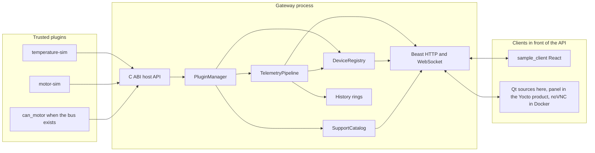

# Open Gateway — Implementation Plan

**Status:** Ready to implement  
**Source:** [PRD.md](PRD.md)  
**Scope of this plan:** Milestones M1–M6. M7 is sequenced only far enough to avoid painting the architecture into a corner.

This plan freezes the decisions in PRD §11 so implementation can start. Each milestone is independently demonstrable and leaves the gateway runnable. The gateway is headless on Azure and on a Raspberry Pi 4. `sample_client` is the React consumer. A Qt/QML application is the edge screen and talks only to the Gateway API. This repository ships that application’s sources. A separate product owns the Yocto image and U-Boot; it includes this source and builds it with the Qt from that image. In this product’s Docker deployment the same UI is shown in a browser through noVNC. The first physical device is the bare-metal controller over CAN. A simulated sensor runs only when no real sensor is connected.

## 1. What “done” means

The project is ready to showcase when the eleven demo success criteria in PRD §9 hold:

1. With no real sensor attached, the gateway runs the simulated temperature sensor. With a real sensor attached, that sensor is shown and the simulated sensor is inactive.
2. A second trusted `.so` is activated while the process keeps running.
3. Activation adds devices and capabilities with no core code change.
4. An already-open dashboard renders those measurements with no frontend rebuild.
5. The core, the Qt frontend, and `sample_client` do not depend on whether data came from a simulator, CAN, or a later transport.
6. Faults and disconnections show as explicit status.
7. Automated tests and a container demo exist.
8. An architecture description and an “add a plugin” tutorial are in the repo.
9. An already-open client lists only the export methods and sources the gateway advertises, and shows a new configuration option after a new source is connected, with no client change.
10. On a Raspberry Pi 4, the separate Yocto product’s build of this Qt frontend lists connected devices on the 7-inch display and can enable and disable simulated devices through the Gateway API. This product’s Docker deployment of that UI shows the same screen in a browser through noVNC.
11. With the bare-metal controller attached over CAN, that controller is the connected device on the Qt dashboard and in `sample_client`, and the simulated sensor is inactive. Detaching the controller makes the simulated sensor active again.

The gateway process draws nothing. Two clients sit in front of its API:

- `sample_client` is the React dashboard. Local Compose and Azure serve it. It is the client now developed under `web/dashboard`, moved to `sample_client/`. Where the gateway container cannot see a USB CAN adapter, this client opens that adapter in the browser and treats it as the real sensor.
- `edge/display` is the Qt/QML application. This repository contains its sources. The separate Yocto product builds them with that image’s Qt for the 7-inch panel. In Docker it is a separate container whose screen is published through noVNC. The Pi does not need `sample_client` for the panel. Azure does not run Qt.

Both clients may change only options present in the support description. Neither can upload a native plugin, name a file path, or submit an id the gateway did not advertise.

Placing a new `.so` on disk is a deployment action. A local operator copies the library into `pluginDir` and asks the gateway to scan. The gateway then tells connected clients about the new source. On Azure the image already contains the trusted simulators, one of them inactive, so `sample_client` can activate it. The Azure image has no CAN plugin and no display. The Azure showcase does not add a telemetry database. History stays in the gateway process.

The controller firmware stays in its own project. This repository ships the CAN source adapter and the screen that shows the device the adapter registers.

## 2. Locked design decisions

| # | Decision | Choice |
| --- | --- | --- |
| 1 | Plugin binary boundary | Stable **C ABI**. Plugin authors write C++ against a small SDK that exports the C entry points. The host includes only the C header. |
| 2 | How plugins are found | Scan `pluginDir` at startup, plus an operator HTTP call to scan again. No filesystem watch in the MVP. Activation of a plugin the scan already found is a public support call, not a path-based load. |
| 3 | Extension shape | **Sources** are plugins. One plugin entry point registers one or more device sources. Transport details stay inside the plugin. **Exports** (REST, the live channel, and later MQTT or gRPC) are host modules registered with the support catalog. They are not `.so` plugins in the MVP. The client sees both through one support description. |
| 4 | HTTP and live updates | **Boost.Beast** for HTTP and WebSocket, hidden behind a narrow API adapter. JSON at the boundary uses **nlohmann/json**. Live channel is a WebSocket at `/api/v1/stream`. Support changes use that same socket. |
| 5 | Sample client | **Vite + React + TypeScript** in `sample_client/`. A presentation registry maps `valueType` and optional `presentation` to components. A second registry renders the support description as export rows and source rows. Unknown hints and unknown setting types fall back to plain text. The client names no simulator, no export, and no CAN device. |
| 6 | Threads | Boost.Asio `io_context` pool. Plugin threads call a thread-safe host API that **copies inputs and enqueues**. A single consumer strand applies registry, telemetry, and support-catalog updates. |
| 7 | History | In-memory ring buffer per capability (default 600 samples). No database in the MVP and none in the Azure showcase. |
| 8 | Azure | Two containers on **Azure Container Apps**: the headless gateway, and nginx serving `sample_client` while proxying `/api`. Public ingress is that sample client. Scan, CAN, and the Qt app stay off that ingress. Support reads and support updates for advertised ids are on the public API. Bicep under `infra/azure/`. No telemetry store and no display. |
| 9 | Dependency injection | Constructor injection in one composition root (`Application`). No DI container and no service locator. The composition root registers the exports the binary actually contains. |
| 10 | Build and test | CMake + Ninja, C++23, GCC 14, all inside Docker. **Catch2** for gateway tests. AddressSanitizer and UndefinedBehaviorSanitizer on the unit-test job. The Qt app is built in its own Docker image. |
| 11 | Edge display | **Qt 6 Quick / QML** in `edge/display/`. It uses the Gateway API over HTTP and does not link the gateway. The layout targets the official 7-inch panel, **800×480**. This repository does not contain the Yocto layer or U-Boot. The separate board product includes these sources and links the Qt from its image. A Docker deployment here runs the same UI behind noVNC so a browser can show the screen. The gateway process never receives the display. |
| 12 | CAN and sensor selection | A **SocketCAN** plugin, `can_motor`, built only against the SDK. It is a real source. The host probes real sources first. A missing interface leaves that source inactive with an empty error, and the configured simulated sensor then starts. While a real sensor is connected, simulated sources stay inactive. The Azure image has no CAN plugin, so it uses the simulator. There is no CANopen stack. The frame map is data inside the plugin. |

### Why the C ABI

The product’s main claim is that a shared library can be loaded into a running process. A C++ ABI would tie that claim to one compiler and standard-library version. The C boundary makes ownership and lifetime explicit: every string the host keeps is copied before the call returns, and the host never retains plugin pointers.

The SDK still lets a plugin author write an ordinary C++ class. The exported functions are generated by a macro in the SDK, so the ABI is not hand-rolled in every plugin.

### Why exports are not plugins

An export is a way to retrieve data from the gateway. REST and the WebSocket exist so the client can render devices and the support description. Putting those listeners in a `.so` would make the control plane depend on the plugin loader. The composition root registers each export the binary contains. A build without MQTT does not register MQTT, and the client therefore never draws an MQTT switch. A later MQTT or gRPC listener registers with the same catalog and needs no client change.

### Why the screen is a separate process

The person at the Pi looks at Qt on the panel. That image is built by the separate Yocto product from this source, with that image’s Qt. A Docker deployment in this product is looked at through noVNC in a browser. Azure visitors look at `sample_client`. All of these are clients of one API, so a new device appears without a client change. The Qt process can close, or the browser can disconnect, and the gateway keeps sampling. The gateway process never receives the display.

### Why constructor injection

The audience is architects inspecting extension points. A composition root that receives `DeviceRegistry`, `TelemetryPipeline`, `PluginManager`, `SupportCatalog`, and `ApiServer` as constructor arguments is easier to test and to read than a container. Plugins receive host services through the ABI function table, which is the injection point across the binary boundary.

## 3. Architecture



### Module boundaries

| Target | May depend on | Must not depend on |
| --- | --- | --- |
| `ogw_core` | C++ standard library | Sockets, `dlopen`, Beast, plugin `.so` files, JSON library |
| `ogw_sdk` | C ABI header, C++ standard library | `ogw_core`, Beast |
| `ogw_host` | `ogw_core`, C ABI, `libdl` | Beast, concrete plugins, concrete exports |
| `ogw_api` | `ogw_core`, Beast, nlohmann/json | `dlopen`, concrete plugins |
| `ogw` executable | All of the above | Plugin implementations (plugins are loaded, never linked) |
| `temperature_sim`, `motor_sim`, `can_motor` | `ogw_sdk` only | Gateway core, each other, Qt, React |
| `edge/display` | Qt 6, the HTTP API | `ogw_core`, `dlopen`, plugin `.so` files, SocketCAN |

`SupportCatalog` lives in `ogw_host` as data: export ids, enabled flags, source ids, lifecycle state, and setting values. It does not include Beast or `dlopen`. `ogw_api` serializes it and applies validated updates. The composition root is the only place that knows the concrete export set of this binary.

`motor_sim` is also built by a standalone CMake project under `plugins/motor_sim/` that is given only the installed SDK. That build is the proof for FR-02 and FR-10.

### Repository layout

```text
CMakeLists.txt
cmake/toolchains
include/ogw/                 core and host headers
src/core/                    registry, telemetry, clock, log
src/host/                    loader, lifecycle, support catalog
src/api/                     HTTP routes, WebSocket hub
src/app/application.cpp
src/main.cpp
sdk/include/ogw/sdk/         C++ plugin base and export macro
sdk/src/
plugins/temperature_sim/     started with the gateway in the demo
plugins/motor_sim/           standalone CMake project, activated at runtime
plugins/can_motor/           SocketCAN plugin, real source, probed before simulators, M6
tests/unit/
tests/integration/
sample_client/               Vite React sample consumer, moved from web/dashboard
edge/display/                Qt 6 Quick sources. The separate Yocto product builds them for the panel
docker/                      Dockerfiles, compose, nginx config, noVNC display image
docs/architecture.md
docs/add-a-plugin.md
docs/pi.md                   How the separate Yocto product consumes this source, and CAN, added in M5 and M6
infra/azure/                 Bicep, added in M5
.github/workflows/ci.yml
```

Dockerfiles, Compose files, and the nginx config live under `docker/`. Images are built from the repo root as the context.

### Runtime processes

Local Compose runs three services:

- `gateway` listens on an internal port only. It draws nothing. It probes real sources first and starts the temperature simulator only when none is connected.
- `web` (nginx) serves `sample_client` and proxies `/api/` to the gateway, including the WebSocket upgrade.
- `display` runs the Qt UI against a virtual 800×480 screen and publishes it with noVNC. The gateway service does not receive that screen.

The Raspberry Pi image is not built in this repository. A separate product owns Yocto and U-Boot, includes this source, and links `edge/display` against the Qt in that image. That image starts the gateway and the Qt application on the 7-inch panel, probes `can_motor` at startup, and does not use the noVNC container. `sample_client` is optional on the Pi. The Docker display service does not use the panel.

The operator scan API is a separate listener, bound to `127.0.0.1` inside the gateway container, published to the host only in the local demo compose file. The cloud template and the Pi compose file do not publish it and set `adminApi` off, so the scan route is not registered there. The Pi screen enables sources that are already installed.

Support reads and support updates are on the public listener. They are how the client configures the gateway. They accept ids, booleans, and setting values. They never accept a path, a URL, or a plugin binary.

## 4. Domain model

Types live in `ogw_core` and are the only model the API and the UI need.

### Identifiers

- Plugin id, device local id, capability id, export id, and setting name are non-empty strings limited to `[A-Za-z0-9._-]`, max 64 characters.
- The registry key for a device is `{pluginId}/{localDeviceId}`.
- A capability id is unique within a device.
- An export id and a source id are unique in the support catalog.

### Capability

| Field | Required | Notes |
| --- | --- | --- |
| `id` | yes | Stable within the device |
| `kind` | yes | MVP value is always `measurement` |
| `valueType` | yes | `number`, `bool`, `enum`, or `string` |
| `displayName` | yes | |
| `unit` | no | Display string, used for numbers |
| `presentation` | no | Hint: `value`, `gauge`, `sparkline`, `status` |
| `range` | no | `min` / `max` for gauges |
| `enumStates` | for enums | `{ id, label, tone }` where tone is `neutral`, `ok`, `warn`, or `fault` |
| `staleAfterMs` | yes | Host marks the current reading stale when receive time exceeds this |

`kind` other than `measurement` is stored and forwarded. The MVP UI renders a measurement view only for `kind == measurement`. A numeric measurement therefore does not grow a command control. That is the FR-11 rule.

### Reading

| Field | Notes |
| --- | --- |
| `value` | `double`, `bool`, or string. Enum values are strings matching an `enumStates` id |
| `quality` | `good`, `uncertain`, `bad`, `stale` |
| `sourceTimestamp` | UTC milliseconds supplied by the plugin |
| `receivedAt` | UTC milliseconds stamped by the host |
| `detail` | Optional short reason, for example `above_range` or `disconnected` |

Invalid combinations are rejected and counted: unknown capability, value type mismatch, enum token not in the descriptor, or non-finite number. A rejected reading does not replace the current value. The rejection is logged and exposed as a pipeline counter.

### Device status

`connected`, `disconnected`, or `faulted`. This is separate from reading quality.

When a plugin reports the device disconnected:

- Device status becomes `disconnected`.
- The last numeric or text value is kept.
- Quality on current readings becomes `stale` and `detail` becomes `disconnected`.
- The original `sourceTimestamp` is kept so the UI can show when the value was last real.

An out-of-range demonstration publishes the measured number with quality `bad`. The UI shows the number and a fault badge together.

### Plugin lifecycle

States: `discovered`, `loaded`, `active`, `inactive`, `failed`.

```text
discovered --load--> loaded --activate--> active
active --deactivate--> inactive --activate--> active
any --error--> failed
shutdown: active|inactive|loaded --stop and destroy--> (handle kept until process exit)
```

- `load`: `dlopen`, resolve `ogw_plugin_create` / `ogw_plugin_destroy`, construct, check ABI version, call `init`. On any failure the state is `failed`, the error string is kept, and the process continues.
- `activate`: call `start`. The plugin may register devices after this returns, from its own threads.
- `deactivate`: call `stop`, then drain the host queue, then mark that plugin’s devices `disconnected` if the plugin did not already do so.
- Shutdown: deactivate every active plugin, destroy plugin objects, then leave the libraries mapped. `dlclose` is intentionally not called in the MVP (PRD FR-03).
- A `failed` plugin can be loaded again after the file is replaced, via a new scan. The previous handle stays mapped.

Every successful scan, load, activate, deactivate, or failure updates the support catalog and fans out a support event.

### Host call rules

Documented in the plugin guide and enforced by the host implementation:

- Host API functions copy every string and value before they return.
- They enqueue work. They do not call back into the plugin on that stack.
- `log` is synchronous, thread-safe, and does not call the plugin.
- After `ogw_plugin_destroy` returns, the host does not call the plugin again.
- The plugin does not use host pointers after `stop` returns.

### Support catalog

The catalog is the menu the client is allowed to render and to edit.

An **export** entry:

| Field | Notes |
| --- | --- |
| `id` | `rest` or `websocket` in the MVP |
| `enabled` | Whether that retrieval method is currently serving telemetry |
| `mutable` | When false, a client update that would change it is rejected |
| `settings` | Declared settings. Empty for both MVP exports |

A **source** entry:

| Field | Notes |
| --- | --- |
| `id` | Plugin id |
| `name` | Display name from the plugin |
| `version` | Plugin version |
| `state` | Lifecycle state |
| `error` | Last failure string, or empty |
| `settings` | Settings this source accepts, plus current values |

The MVP binary registers two exports, both mutable:

- `rest` covers the telemetry GET routes. It does not cover health, support, or support updates.
- `websocket` covers `/api/v1/stream`.

Health, `GET /api/v1/support`, and the support update routes stay available when either export is off. That is the control plane. A reviewer can turn the live channel off and still turn it back on. Disabling `rest` makes telemetry GET routes respond `409` with code `export_disabled`. Disabling `websocket` closes open streams and rejects new upgrades with the same code. Device data already on screen stays put. The client keeps a usable console because support GET still works.

There is no `mqtt` or `grpc` entry unless that listener is linked into the binary. The PRD’s example MQTT object is illustrative for a later build, not an MVP catalog entry.

Settings on a source are applied by stopping and starting that plugin with the new config document. A setting the plugin did not declare is rejected. The telemetry gap during the restart is a normal deactivate followed by activate.

## 5. C ABI and SDK

Header: `sdk/include/ogw/plugin_abi.h`. Version constant: `OGW_PLUGIN_ABI_VERSION` = 1. A mismatch fails that plugin only.

Exported symbols, default visibility hidden on the `.so`, these two exported:

```c
ogw_plugin* ogw_plugin_create(const ogw_host_api* host, const char* config_json);
void ogw_plugin_destroy(ogw_plugin* plugin);
```

`ogw_plugin` is an incomplete type with an explicit vtable the host calls:

- `get_info` → id, display name, version, abi version
- `init`
- `start`
- `stop`
- `describe_settings`, optional

The vtable begins with `size`. The host calls `describe_settings` only when `size` includes that slot. An older plugin with a shorter vtable advertises an empty settings list and can still be activated. Each required call returns 0 on success or a stable positive error code. Detail strings go through a caller-provided buffer so the host does not free plugin memory.

`describe_settings` writes a JSON array of `{ "name", "valueType", "min", "max" }`. `valueType` is `number`, `bool`, or `string`. The host parses and stores that array. It does not trust setting values from the plugin binary beyond this declaration; the client’s submitted values are checked against it.

`ogw_host_api` is a struct of function pointers plus `abi_version` and `user_data`:

- `log`
- `register_device`, `update_device`, `remove_device`
- `publish_reading`
- `wall_time_ms`

Device registration takes a JSON document whose schema is the public capability descriptor (PRD §6, extended with the fields in §4). JSON is used at the boundary so the C struct does not become a second schema. The host parses it inside `ogw_core`-facing code in the host module and rejects unknown required fields with a plugin error, without dropping the plugin unless `init`/`start` itself fails.

The C++ SDK class:

```text
class Plugin {
 public:
  virtual ~Plugin() = default;
  virtual Info info() const = 0;
  virtual void init(const Config& config) = 0;
  virtual void start() = 0;
  virtual void stop() = 0;
  virtual std::string settings_schema() const;  // default "[]"
 protected:
  HostServices& host();   // thin wrappers over ogw_host_api
};
OGW_EXPORT_PLUGIN(MyPlugin)
```

`HostServices` methods throw on a rejected registration inside the plugin process only as SDK exceptions caught by the export trampoline and converted into error codes. Plugin `start` failures become plugin state `failed` and a support update.

## 6. Telemetry path and concurrency

1. A plugin thread calls `publish_reading`.
2. The host copies the reading into a bounded queue (capacity 4096).
3. If the queue is full, the oldest reading is dropped and `telemetry_dropped` increments.
4. The consumer strand validates the reading, updates the current-value map, appends to the history ring, and fans out a WebSocket event when the `websocket` export is enabled.
5. Device registration and support-catalog changes use a separate mutex-protected path and are not dropped. Their volume is tiny compared with readings.

Staleness is evaluated when a current value is read and on a one-second timer, using an injected `Clock`. Tests advance the fake clock instead of sleeping.

WebSocket fan-out iterates sessions on the consumer strand. A slow client has a per-session outbound queue of 256 messages. On overflow the hub drops to a fresh snapshot message for that session and increments `ws_coalesced`. The snapshot includes devices, plugins, and the support description.

Shutdown sets a flag, stops plugins, drains both queues, stops the `io_context`, and joins threads.

A support update is applied on the consumer strand before the matching `support` event is sent, so a client that acts on the event sees the same catalog `GET /api/v1/support` returns.

## 7. HTTP API

Prefix `/api/v1`. Errors are JSON: `{ "error": { "code": "...", "message": "..." } }` with an appropriate status.

| Method | Path | Who | Purpose |
| --- | --- | --- | --- |
| GET | `/api/v1/health` | public, always | Process up, version, abi version, uptime. 200 while the process can serve, even if every plugin failed |
| GET | `/api/v1/support` | public, always | Export methods and installed sources, enabled state, whether each source is simulated, settings |
| PUT | `/api/v1/support/exports/{id}` | public, always | `{ "enabled": true, "settings": {} }` for an advertised export |
| PUT | `/api/v1/support/sources/{id}` | public, always | `{ "state": "active" or "inactive", "settings": {} }` for an advertised source |
| GET | `/api/v1/plugins` | public | Id, version, state, error, device counts. `409` when `rest` is disabled |
| GET | `/api/v1/devices` | public | Descriptors plus current readings and device status. `409` when `rest` is disabled |
| GET | `/api/v1/devices/{id}` | public | One device. `409` when `rest` is disabled |
| GET | `/api/v1/devices/{id}/capabilities/{cap}/history?limit=` | public | Oldest-to-newest ring samples. `409` when `rest` is disabled |
| GET | `/api/v1/telemetry/current` | public | Flat list of current readings. `409` when `rest` is disabled |
| GET | `/api/v1/metrics` | public | Counters. `409` when `rest` is disabled |
| WS | `/api/v1/stream` | public | Live events. Upgrade rejected when `websocket` is disabled |
| POST | `/api/v1/admin/plugins/scan` | operator | Rescan `pluginDir`. Registered only when `adminApi` is true |

`{id}` on a support route must already be in the catalog. An unknown id is `404` with code `not_advertised`. A body that contains `path`, `file`, `url`, or inline bytes is `400` with code `upload_rejected`. A value that fails the declared setting type, min, or max is `400` with code `invalid_setting`. Changing an export whose `mutable` is false is `400` with code `not_mutable`.

There is no upload route and no route that accepts a filesystem path from the client.

Operator scan exists only on the admin listener. It discovers `*.so` files in `pluginDir`. Names containing `/` or `..` are ignored. The loader never opens a path outside that directory. After a new library loads, the public stream receives a `support` event. The client can then activate that source. Scan does not activate it.

`state` on a source update is only `active` or `inactive`. Any other token is `400`. Activation calls the existing lifecycle. Settings, when present, become the config document for that start.

### Support document

`GET /api/v1/support` returns:

```json
{
  "exports": [
    { "id": "rest", "enabled": true, "mutable": true, "settings": [] },
    { "id": "websocket", "enabled": true, "mutable": true, "settings": [] }
  ],
  "sources": [
    {
      "id": "temperature-sim",
      "name": "Temperature simulator",
      "version": "0.1.0",
      "state": "active",
      "error": "",
      "simulated": true,
      "settings": [
        { "name": "intervalMs", "valueType": "number", "min": 200, "max": 60000, "value": 1000 }
      ]
    }
  ]
}
```

The motor source is absent until a scan finds it. A gateway binary without a WebSocket listener would omit the `websocket` object. The MVP binary includes both. Every source entry includes `simulated`. A source whose id ends in `-sim` is simulated unless the host config sets `simulated` explicitly. The example above is the catalog when no real sensor was found, so the temperature simulator is the active source.

### WebSocket envelopes

Server sends text frames:

```json
{ "type": "snapshot", "time": "...", "devices": [], "plugins": [], "support": {} }
{ "type": "reading", "deviceId": "...", "capabilityId": "...", "value": 21.5, "quality": "good", "sourceTimestamp": "...", "receivedAt": "...", "detail": null }
{ "type": "device_upsert", "device": {} }
{ "type": "device_removed", "deviceId": "..." }
{ "type": "plugin_state", "plugin": {} }
{ "type": "support", "support": {} }
```

On connect the server sends one `snapshot` that includes `support`. The client sends no application messages in the MVP. The connection itself is the subscription. Configuration is HTTP, so a client can change an option even while the socket is disabled.

A catalog change emits `support` with the full description. The client replaces its configuration state from that object. It does not merge in options the event omitted.

### CORS and proxy

nginx terminates the browser origin and proxies HTTP and WebSocket to the gateway, so the browser does not talk to the gateway port. The gateway still sends `Access-Control-Allow-Origin` only when `corsOrigin` is set, for tests that hit the gateway directly. nginx does not proxy the admin port.

## 8. Configuration

One JSON file, path given by `OGW_CONFIG`. Environment variables override file values so Compose and Container Apps stay simple.

| Key | Env override | Default |
| --- | --- | --- |
| `httpPort` | `OGW_HTTP_PORT` | `8080` |
| `adminApi` | `OGW_ADMIN_API` | `false` |
| `adminPort` | `OGW_ADMIN_PORT` | `8081` |
| `pluginDir` | `OGW_PLUGIN_DIR` | `/var/lib/ogw/plugins` |
| `historySamples` | `OGW_HISTORY_SAMPLES` | `600` |
| `logLevel` | `OGW_LOG_LEVEL` | `info` |
| `exports.rest` | `OGW_EXPORT_REST` | `true` |
| `exports.websocket` | `OGW_EXPORT_WEBSOCKET` | `true` |

Plugins are listed by id with the config object passed to `ogw_plugin_create`:

```json
{
  "httpPort": 8080,
  "adminApi": true,
  "pluginDir": "/var/lib/ogw/plugins",
  "exports": { "rest": true, "websocket": true },
  "plugins": [
    {
      "id": "can-motor",
      "file": "libcan_motor.so",
      "activate": true,
      "simulated": false,
      "config": { "interface": "can0" }
    },
    {
      "id": "temperature-sim",
      "file": "libtemperature_sim.so",
      "activate": true,
      "simulated": true,
      "config": {
        "intervalMs": 1000,
        "seed": 1,
        "timeline": [
          { "forMs": 20000, "mode": "normal" },
          { "forMs": 10000, "mode": "out_of_range" },
          { "forMs": 10000, "mode": "disconnected" }
        ]
      }
    }
  ]
}
```

`file` is operator configuration on the gateway host. It is not a field of the support description and is not accepted from the client. `simulated` is host configuration too. The support description reports the resolved flag. It does not accept a change to that flag from the client.

At startup the host loads every configured plugin without activating it, then probes each real source whose `activate` is true. A real source whose hardware is absent stays `inactive` with an empty `error`. That result is distinct from `failed`. If any real source then has a connected device, simulated sources stay inactive. If none does, the host activates each simulated source whose `activate` is true. That is the fallback. `motor-sim` is simulated with `activate: false`, so it is not the fallback.

When a real source later gains a connected device, the host deactivates simulated sources that are active and remembers them. When the last real device disconnects, the host activates those remembered sources again. A simulated source the operator turned off while no real sensor was connected stays off.

`motor-sim` is absent from the default local config. The runtime demo copies the `.so` into `pluginDir` and calls operator scan. The open client then shows the source as inactive, and the reviewer activates it there. Its own timeline uses modes `running`, `fault`, and `disconnected` for speed, state, and winding temperature.

The cloud config lists both simulators and no CAN plugin, with temperature `activate: true` and motor `activate: false`, and sets `adminApi` false. With no real source present, temperature is the active sensor. The public client can still activate the motor while no real sensor is connected. No volume is mounted for plugin upload.

The local JSON above is the shape from M6 onward. Until `can_motor` exists, the local file lists only `temperature-sim`, and that simulator is the active source because no real source is configured. The test profile stays on that temperature-only file so the integration suite does not require a CAN interface.

`intervalMs` is the one client-visible setting on each simulator. Other timeline fields stay in the host config. A support update that includes `intervalMs` restarts that plugin with the previous config plus the new interval.

Logging is line-oriented JSON on stdout: `ts`, `level`, `component`, `msg`, and optional `pluginId`, `deviceId`. No logging framework. Container stdout is not a telemetry database.

## 9. Simulators

Both simulators are plugins. Nothing in `ogw_core` knows about temperature or motors. Neither name is hard-coded in `sample_client` or in the Qt screen.

### temperature-sim

Shipped in the gateway image. It is the configured fallback: activated at startup when no real sensor is connected, and inactive while one is.

- Device `temperature-sim/room-1`, display name “Room Sensor”.
- Capabilities: `temperature` (number, `°C`, gauge, range −10..50), `humidity` (number, `%`, sparkline, range 0..100).
- Deterministic phase timeline from config and `seed`. `normal` publishes quality `good`. `out_of_range` publishes a value above the stated range with quality `bad` and detail `above_range`. `disconnected` sets device status and stops good readings.
- `describe_settings` declares `intervalMs` as a number from 200 to 60000.
- Interval and timeline are config. Tests use short durations.

### motor-sim

Built only against the SDK. Loaded after the gateway is already serving.

- Device `motor-sim/motor-01`, display name “Simulated Motor”.
- Capabilities: `speed` (number, `rpm`, gauge), `state` (enum: `stopped`, `running`, `fault`), `winding_temperature` (number, `°C`, value).
- Timeline modes mirror the temperature plugin so the client shows a second source plus a fault and a disconnect.
- `describe_settings` declares the same `intervalMs` setting.

`scripts/demo-activate-motor.sh` copies the standalone-built `.so` into the plugin directory of a running Compose stack and calls operator scan only. It does not activate. Activation is the client’s support update, which is the demonstration of criteria 2–4 and 9. The integration test may call `PUT /api/v1/support/sources/motor-sim` itself.

## 10. Sample client

`sample_client` is the Vite app moved from `web/dashboard`. nginx serves `dist/`. The gateway serves no HTML. This client is the Azure and local-browser dashboard. It is not the Pi panel.

Data flow:

1. On load, `GET /api/v1/support`. If `rest` is enabled, also `GET /api/v1/devices` and `GET /api/v1/plugins`.
2. If `websocket` is enabled, open `WebSocket` to `/api/v1/stream`.
3. Apply `snapshot`, then patch device state for `reading`, `device_upsert`, `device_removed`, and `plugin_state`. Replace the whole support object on `snapshot` and on `support`.
4. If `websocket` is disabled and `rest` is enabled, poll the device and support GETs about once a second.
5. If both exports are disabled, keep the last device snapshot and keep refreshing support so the console can turn an export back on.
6. Reconnect the socket with backoff while `websocket` is enabled. On reconnect, replace state from the next snapshot.

Presentation registry:

| valueType | presentation | Component |
| --- | --- | --- |
| number | `gauge` | Gauge, unit, sparkline, quality badge |
| number | `sparkline` or absent | Value card and sparkline |
| bool | any | Status pill |
| enum | any | Label from `enumStates`, color from `tone` |
| string | any | Text card |
| anything else | any | Plain card showing the raw value and type |

Each card shows display name, device status, quality, unit, and the source timestamp. Quality `bad`, `stale`, or device `disconnected` is a visible badge. The last number stays on screen and is labeled as not live.

History for sparklines comes from the snapshot’s embedded recent samples (last 60) and then from `reading` events. The history endpoint is used if a card is opened after a gap and `rest` is enabled.

Support panel, built only from `GET /api/v1/support` and `support` events:

| Entry | Control |
| --- | --- |
| Export with `mutable: true` | A switch bound to `enabled`. No settings fields when `settings` is empty |
| Export with `mutable: false` | The name and state, with no switch |
| Source `inactive` or `failed` | Activate, the error string when present, and one input per declared setting |
| Source `active` | Deactivate, and the same setting inputs. Submitting settings restarts that source |
| Any other shape | The id and state as text |

The panel has no file picker, no path field, and no control for an id that is not in the document. Turning a switch calls `PUT /api/v1/support/exports/{id}`. Activate, deactivate, and settings call `PUT /api/v1/support/sources/{id}`.

The device list prefers a connected real sensor. A source with `simulated: true`, or an id ending in `-sim` when the flag is absent, is simulated. While any non-simulated device is `connected`, simulated devices are left off the dashboard. When no real sensor is connected, the simulated devices stay on the dashboard. The support panel still lists every advertised source, so an operator can enable or disable a simulator while no real sensor is connected.

On a developer machine the gateway container cannot see a USB CAN adapter. The page then uses the browser’s WebUSB to open an adapter the user has already allowed: vendor `0x1d50`, product `0x606f`, the SH-C31A class of gs_usb device, at 500 kbit/s. A previously granted adapter is opened on load. The first grant still needs the Connect control, because the browser only shows the permission prompt from a user gesture. Frames with id `0x101` update a local showcase card: encoder counts, duty, and direction. While that card is open the page treats it as the real sensor, hides simulated devices, and deactivates active simulated sources through the support API. Closing the adapter restores the sources that deactivation suspended. The gateway’s SocketCAN plugin remains the path when the host can see `can0`. The page does not invent a second card when the gateway already has a connected real device.

No device-specific React components exist for the simulators or for the CAN controller. A widget test renders a fixture device of each value type, including an unknown presentation hint. A support-panel test renders a fixture catalog, confirms an unknown export id is not invented, and confirms a newly arrived source row appears when a `support` event replaces the catalog. A selection test shows the simulator when no real device is connected, and hides it when a real device is connected or the local adapter is open.

## 11. Qt edge frontend

`edge/display` is a Qt 6 Quick application. The same sources have two deployments.

**Docker.** `docker/Dockerfile.display` builds the application in an image that contains Qt 6 (base and declarative) and CMake. The runtime stage runs that binary on a virtual 800×480 display and serves it with noVNC. Local Compose publishes that page, and a browser shows the Qt screen there. The developer machine does not need a host Qt install. CI compiles this image, runs the windowless test below, and checks that the noVNC page is served. A browser pass opens the noVNC URL and confirms the device list is on screen.

**Raspberry Pi.** This repository does not contain a Yocto layer, U-Boot, or a board image. The separate product that demonstrates those includes this source and builds `edge/display` with the Qt already in that image. It does not fetch a second Qt. `docs/pi.md` says that, names `OGW_API`, the 800×480 layout, and `can0`. The Docker image is the compile check for these sources in this repository.

The process has one window, 800×480, touch targets at least 48 pixels. On the panel it has no window decorations. In Docker the noVNC page shows that same window.

The screen has two regions, both filled from the API:

- **Connected devices.** One row per device from `GET /api/v1/devices` and from `device_upsert`, `device_removed`, and `reading` on `/api/v1/stream`. Each row shows display name, device id, and connection status. A `disconnected` or `faulted` status is a visible badge. The list updates while the application stays open.
- **Sources.** One switch per entry in the support description. Active calls `PUT /api/v1/support/sources/{id}` with `state: inactive`. Inactive or failed calls it with `state: active` and shows the error string when present. The screen does not special-case source ids. The gateway decides which source is active: the real sensor when one is connected, and the simulated sensor when none is. A source that is inactive because its hardware is absent has an empty error, so the screen does not present that as a fault.

There is no file picker and no path field. The application does not open a CAN socket. Closing it does not stop the gateway container.

Data flow matches §10, with Qt types instead of React: `QNetworkAccessManager` for HTTP and `QWebSocket` for the stream. If the WebSocket export is off and REST is on, the view polls about once a second. Support GET stays available so a switch can turn the stream back on.

A Qt Test binary, run in the display image without a window, feeds fixture JSON through the same model the QML binds to. It checks that a device row appears from a snapshot, that a support event adds a source switch, and that an id absent from the document produces no switch.

`docs/pi.md` records that the panel image is built by the separate Yocto product from this source, the 800×480 layout, and `can0`. The local Compose file starts the noVNC service. The Pi image does not.

## 12. CAN source

`plugins/can_motor` is a standalone SDK plugin, same shape as `motor_sim`. It links the SDK and the system SocketCAN headers. It does not link the gateway, Qt, or a CANopen library. The cloud image does not copy it. The local image does, and the separate Yocto product’s image does when it builds this source. Both list it as a real source with `activate: true`. The host probes it before any simulated source.

The plugin owns the frame map for the bare-metal showcase. The map is data inside the plugin, not a schema in `ogw_core`. The controller sends a status frame at id `0x101` about every 100 ms, at 500 kbit/s:

| Signal | Bytes | Meaning |
| --- | --- | --- |
| `encoder_counts` | 0–3, signed int32, little-endian | Encoder counts |
| `duty` | 4, unsigned | Duty in percent |
| `direction` | 5 | `0` is CW, any other value is CCW |

The device local id is `showcase`, the display name is “Bare-metal showcase”, and `staleAfterMs` is 1000. The interface defaults to `can0`. A decoded signal becomes a normal measurement registration and a normal reading. Direction is published as the string `CW` or `CCW`. If no frame arrives within `staleAfterMs`, the plugin marks the device `disconnected`, and the host’s selection rule brings the simulated sensor back. If `can0` cannot be opened, `start` reports the sensor absent. The support entry stays `inactive` with an empty error. It is not `failed`. The temperature simulator then starts.

The decoder is a pure function. The plugin’s own test feeds the status frame a crafted payload and checks counts, duty, and direction. It does not need a CAN interface. Socket setup stays a thin adapter around that function. CI does not require `NET_ADMIN` or `vcan`.

On the Pi, a present controller is the device the Qt screen shows, and the temperature simulator is inactive. Unplugging CAN returns the simulator. `sample_client`, pointed at the Pi gateway, shows the same device because it also reads the API. On a machine whose container cannot see the USB adapter, `sample_client` reads the same frame through WebUSB, as described in §10, and the noVNC view shows whatever the gateway itself can see.

## 13. Testing

### Unit tests (`ogw_core`, host logic with a fake dynamic library where needed)

- Registry: add, update metadata, remove, stable ids, two plugins with the same local device id.
- Reading validation: type mismatch, bad enum, non-finite number, unknown capability. Current value unchanged.
- Staleness against a fake clock.
- Disconnect preserves the last value and forces quality `stale`.
- Queue overflow drops the oldest and counts it.
- History ring order and capacity.
- Plugin state machine with a fake vtable: failed init, activate, deactivate, shutdown order.
- ABI version mismatch.
- Support catalog: registering `rest` and `websocket` does not create `mqtt`. Updating an unknown id fails. A declared numeric setting rejects a string and a value outside min/max. A source that appears after scan is in the next catalog snapshot and absent before it. Removing it removes the entry. A `-sim` id is reported `simulated: true` unless the config says otherwise. `can-motor` is reported `simulated: false`.
- Sensor selection: a requested real source is probed and a requested simulated source is not, while a real device is connected. With no real device connected, the requested simulated source is the one that starts. A simulated source with `activate: false` stays inactive. A missing real sensor is `inactive` with an empty error, not `failed`. After the real device disconnects, a simulated source that the host suspended is started again. A simulated source the operator had already turned off is not.
- A short vtable without `describe_settings` yields an empty settings list and can still activate.

### Integration tests (container)

Run via `docker compose -f docker/compose.yaml -f docker/compose.test.yaml`.

- Gateway becomes healthy with `temperature-sim` active. The test profile configures no real source, so the fallback rule selects the simulator.
- `GET /api/v1/support` lists `rest`, `websocket`, and `temperature-sim`, and does not list `mqtt` or `motor-sim`.
- WebSocket receives a temperature reading with a timestamp and quality, and the snapshot includes `support`.
- `PUT` of `websocket` to disabled closes the stream. `GET /api/v1/support` still returns 200 and shows `websocket.enabled: false`. A following `PUT` turns it back on and a new socket receives readings.
- `PUT /api/v1/support/exports/mqtt` returns `404` `not_advertised`.
- A body that includes a `path` or a plugin payload returns `400` `upload_rejected`.
- Build `motor_sim` with the standalone CMake project, copy the `.so`, operator-scan. The already-open socket receives `support` containing `motor-sim` in state `inactive`, and a `device` is not required until activate.
- `PUT /api/v1/support/sources/motor-sim` with `state: active` makes the device appear on `GET /api/v1/devices` and as `device_upsert` on an already-open socket.
- Deactivate stops further motor readings. Temperature readings continue. Health stays 200.
- A plugin whose `init` returns an error is `failed` in the support description. The other plugin stays active.
- Timeline reaches `disconnected` and the device status is visible on the API.

### Sample client

Typecheck and unit tests for the presentation registry, the device reducer, the support reducer, and the real-versus-simulated selection. The browser check in M3 loads the Compose stack, confirms a reading renders, and confirms the support panel lists the advertised exports. The browser check in M4 confirms the motor source row appears after scan and that activating it from the panel adds the motor card. The browser check in M5 opens the noVNC page and confirms the Qt device list is visible. The browser check in M6, on a machine whose container cannot see the USB adapter, confirms that opening the adapter in `sample_client` shows the showcase card and that the temperature simulator leaves the dashboard.

### Edge display and CAN

The display image builds `edge/display`, runs the windowless Qt Test from §11, and serves the UI through noVNC. The `can_motor` CMake project runs its frame-decoder test inside the toolchain image. Neither job needs the Pi, a panel, or a CAN controller. This repository has no Yocto build.

### CI (GitHub Actions)

One workflow. Gateway steps use the toolchain image. The sample client uses a Node image. The display uses the Qt image.

1. Configure and build with warnings as errors.
2. Unit tests with ASan and UBSan.
3. Standalone `motor_sim` configure against an installed SDK tree.
4. `can_motor` decoder tests, from M6 onward.
5. Compose integration tests.
6. `npm ci`, typecheck, and `sample_client` unit tests.
7. Display image build, the windowless Qt Test, and a check that the noVNC port serves its page, from M5 onward.

The cloud deploy job is manual (`workflow_dispatch`) in M5, not on every pull request. The 7-inch panel is checked in the separate Yocto product, not in this workflow.

## 14. Milestones

Work top to bottom. Do not start a milestone’s integration demo before its unit tests pass.

### M1 — Core contracts

**Outcome:** Device model, registry, telemetry path, and clock are tested without sockets or plugins.

Tasks:

1. Docker toolchain image (`docker/Dockerfile.toolchain`) with GCC 14, CMake, Ninja, and Boost headers available for later milestones. Compose target `test` runs unit tests in that image.
2. CMake project: `ogw_core` static library, C++23, `-Wall -Wextra -Werror`.
3. Types for capability, reading, quality, device status, and ids.
4. `Clock` interface and a manual clock.
5. `DeviceRegistry` with the id rules in §4.
6. `TelemetryPipeline`: validate, current values, history ring, drop counters, staleness.
7. JSON log helper.
8. Catch2 unit tests listed in §11 for the core.
9. CI workflow that builds the toolchain image and runs those tests.

**Done when:** `docker compose -f docker/compose.yaml run --rm unit-tests` is green on a clean machine with only Docker installed, and a test feeds two fake sources into one pipeline.

**PRD:** FR-04 and FR-05 at library level. FR-02’s dependency direction starts here.

### M2 — Runtime extensions

**Outcome:** A `.so` built only against the SDK loads, activates, and publishes into the M1 pipeline. Unload is not implemented. The support catalog records sources without HTTP.

Tasks:

1. `plugin_abi.h` and the host-side loader (`dlopen`, symbol lookup, vtable calls, copied strings), including the optional `describe_settings` slot.
2. C++ SDK: `Plugin`, `HostServices`, `OGW_EXPORT_PLUGIN`, default empty settings schema.
3. `PluginManager` state machine, startup scan, activate, deactivate, shutdown without `dlclose`.
4. `SupportCatalog` updated on every lifecycle change. Unit tests for unknown ids, setting validation, and “no mqtt entry unless registered”.
5. Config file loader for the fields in §8.
6. `temperature_sim` implementing the timeline and declaring `intervalMs`.
7. Standalone `plugins/motor_sim` CMake project that compiles against the SDK install tree and does not link `ogw_core`.
8. Unit tests for the state machine and a temporary test `.so`.
9. docs/add-a-plugin.md first version: ABI rules, SDK skeleton, settings schema, build command, copy into `pluginDir`.

**Done when:** A small driver executable (not the final HTTP server) starts with temperature-sim, then loads motor-sim from a path passed on the command line, and prints both devices’ readings and the support catalog. The driver binary’s link line does not include either plugin. The catalog printed before the second load does not contain motor-sim.

**PRD:** FR-01, FR-02, FR-03, the catalog half of FR-12, and the start of FR-10.

### M3 — Generic API and sample client

**Outcome:** Discovery, the support description, current values, and a client that updates devices and configuration from the WebSocket.

Tasks:

1. `ogw_api` with Beast HTTP and WebSocket, routes from §7. Operator scan stays behind `adminApi`. Support routes are on the public listener.
2. Composition root in `Application`. It registers the `rest` and `websocket` exports and does not register MQTT. Public listener and optional admin listener.
3. Snapshot, patch, and `support` messages from §7. Disabling an export stops that method and leaves support GET running.
4. Per-session outbound bound and coalesce-on-overflow.
5. Move the Vite app to `sample_client/`. Presentation registry and support panel from §10, reducer tests. Remove `web/dashboard` once the move builds.
6. nginx config under `docker/` and a web image that contains only the `sample_client` build plus that config. The gateway image serves no dashboard.
7. Local `docker/compose.yaml`: gateway + web. The temperature plugin is the only configured source, so the fallback rule activates it. Admin scan published to localhost. The noVNC display service arrives in M5.
8. Integration tests: WebSocket reading from temperature-sim, support document contents, disable and re-enable websocket, reject an unknown export id.
9. Browser pass: open the client, see the room sensor change, see the support panel list `rest`, `websocket`, and the temperature source and no MQTT row. Use the in-app browser against the Compose URL.

**Done when:** With the stack up, `curl` can list the device and the support document, the page shows temperature and humidity, a second browser event shows a changed value without reload, and turning the WebSocket export off and on from the panel keeps the console usable.

**PRD:** FR-06, FR-07 for a single source, FR-11 in the UI, FR-12, and the export half of FR-13.

### M4 — Realistic demo

**Outcome:** Two sources, runtime activation from the client, scripted faults, and the integration suite.

Tasks:

1. Finish motor-sim timeline (`running`, `fault`, `disconnected`) and its `intervalMs` setting.
2. `scripts/demo-activate-motor.sh` copies the `.so` and calls operator scan. It does not activate.
3. Public `PUT /api/v1/support/sources/{id}` activates, deactivates, and restarts a source with validated settings.
4. Integration tests from §11, including the support event before activate, “temperature continues after motor deactivate”, “bad plugin does not kill the process”, and rejection of an upload-shaped body.
5. Metrics endpoint and log lines that let a reviewer tell gateway failure, plugin failure, and device disconnect apart.
6. Browser pass of the full primary demonstration in PRD §3: start stack, watch temperature, run the scan script, see the motor source appear on the already-open configuration panel, activate it there, see the motor card appear, wait for or seek a fault phase, deactivate, see status change.

**Done when:** Success criteria 1–6 and 9 are true locally and the integration compose job is green.

**PRD:** FR-08, FR-09, the runtime half of FR-01 and FR-07, and the source half of FR-12 and FR-13.

### M5 — Azure and the noVNC Qt screen

**Outcome:** Repeatable demo, CI, Azure simulated deployment, and the Qt screen in a browser through noVNC. The Pi image stays in the separate Yocto product, which includes this source.

Tasks:

1. Tighten CI to the §13 pipeline that exists at this milestone, including the standalone motor plugin build, `sample_client` tests, and the display image with its windowless Qt Test and noVNC page check.
2. `docker/compose.yaml` documented in the root README: prerequisites (Docker only), `docker compose up`, the `sample_client` URL, the noVNC URL, the scan command, and activation from `sample_client`.
3. `docker/Dockerfile.display` runs the Qt UI on a virtual 800×480 screen and publishes noVNC. Local Compose starts that service beside gateway and web. The gateway container does not receive the display. CAN is not installed yet. `adminApi` stays as the local demo already set it.
4. Qt screen from §11: connected-device list and a switch per advertised source. Touch layout at 800×480.
5. `docs/pi.md`: the panel image is built by the separate Yocto and U-Boot product, which includes this source and uses that image’s Qt. Record `OGW_API`, the 800×480 layout, `can0`, and that closing the Qt application leaves the gateway running. This repository does not add a Yocto layer.
6. Expand docs/architecture.md with the diagram in §3, ownership rules, threading, the support catalog, the real-sensor rule, and why neither client links the gateway.
7. Finish docs/add-a-plugin.md so a third plugin can be added without editing `src/`, `sample_client`, or `edge/display`. Include the settings schema, the `simulated` flag, and a checklist that matches FR-10.
8. Azure Container Apps Bicep: gateway image and web image built from `sample_client`, public ingress only on web, `adminApi` false. Both simulators are baked in. Temperature is active because no real source is present. Motor is inactive. No CAN plugin, no Qt container, no plugin volume, no database.
9. HTTPS via the Container Apps ingress. Support GET and support PUT are on that ingress. Scan is not.
10. Manual deploy workflow and a short docs/azure.md. Telemetry history is in process memory. Deleting the resource group ends the showcase. Container stdout is the only log sink.
11. Browser pass of `sample_client` and of the noVNC page on the local stack. The panel check happens in the separate Yocto product: the Qt list matches the gateway devices, and a switch enables and disables a simulator while no real sensor is connected.

**Done when:** Success criteria 7, 8, and the Docker half of criterion 10 are true in this repository. Azure serves `sample_client` without a CAN device, without a display, and without an upload control. The noVNC page shows the Qt screen.

**PRD:** deployment section, FR-08, FR-10, FR-13, FR-14.

### M6 — CAN device and sensor selection

**Outcome:** The gateway probes the bare-metal controller before it uses a simulator. When the controller is connected, the Qt screen and `sample_client` show it and the temperature simulator is inactive. When it is not, the simulator is the active source.

Tasks:

1. `plugins/can_motor` from §12, standalone against the installed SDK, with the `0x101` status frame and the decoder test.
2. Host startup from §8: probe real sources first, leave a missing interface `inactive` with an empty error, and activate the simulated fallback only when no real device is connected. Suspend that fallback while a real device is connected, and restore it when the real device disconnects. Do not restart a simulator the operator disabled while no real sensor was connected.
3. Local config lists `can-motor` as a real source with `activate: true`, and `temperature-sim` as the simulated fallback. The separate Yocto product uses that same selection when it builds this source. The cloud image still has no `can_motor` library.
4. `sample_client` selection and WebUSB path from §10. A granted SH-C31A opens on load. While it is open, simulated devices leave the dashboard and the support API deactivates the fallback. Closing it restores that fallback.
5. On the Pi, with `can0` up and the controller attached, the panel shows the showcase and the temperature simulator is inactive. Unplugging CAN makes the simulator active again. Point `sample_client` at the Pi gateway and confirm the same device.
6. Confirm the Azure page still runs on the temperature simulator.
7. Note in docs/pi.md that the interface is `can0`, the status frame is `0x101`, and the firmware is not in this repository.

**Done when:** Success criteria 1 and 11 are true. With no CAN interface the dashboard shows the temperature simulator and `can-motor` is inactive with an empty error. With the controller reachable, that controller is shown and the simulator is inactive. The Azure showcase still starts without CAN hardware.

**PRD:** FR-15 and FR-16. FR-02, because the adapter is a plugin. FR-05 and FR-07, because both clients render it from the API.

### M7 — Later, not scheduled in this plan

Recorded so current interfaces do not block them:

- MQTT and gRPC **exports** register with `SupportCatalog` from the composition root when those listeners exist. They appear as mutable exports with their own settings, such as a port. Both clients already render whatever the catalog lists. Payloads for browsers stay JSON on REST and the WebSocket. Protobuf is the gRPC schema and is not the REST body.
- MQTT and gRPC **source adapters** are new SDK plugins. They should look like motor-sim to the host: install, support entry, enable from either client.
- A broader CANopen or motion-control surface stays inside `can_motor` or a successor plugin. The clients still have no CAN-specific page.
- `dlclose` and hot replace only after a design note on in-flight callbacks.
- Persistence, alert rules, and command capabilities. The Azure showcase does not take a persistent store. Commands require an explicit `kind: command` path, a host-side allow list, and an audit log before any control exists.
- Optional UI extensions. The sample client’s fallback card, and the Qt screen’s text row, are the intended answer to unknown presentations until then.

## 15. Suggested first week of work

M1 tasks 1–8, in that order. The first pull request should be the toolchain image, `ogw_core`, and the registry plus pipeline tests. No HTTP, no `dlopen`, and no React until those tests are the regression net for later milestones.

## 16. Risks and mitigations

| Risk | Mitigation in this plan |
| --- | --- |
| C++ exceptions or types leak across the `.so` boundary | Vtable returns error codes. Strings are copied. SDK catches exceptions in the trampoline. |
| A plugin blocks the process in a host callback | Host API only enqueues. `log` does not take the registry lock. |
| Telemetry overwhelms the browser | Bounded ingest queue, bounded per-socket queue, snapshot coalesce. |
| Docker bind mounts make inotify demos flaky | Discovery is an explicit operator scan. The client activates only after the support event. |
| Public demo becomes a way to load native code | The public API accepts advertised ids and declared setting values only. Scan is a separate listener and is off in the cloud. There is no upload route. The client has no file control. The loader never opens a path outside `pluginDir`. |
| A reviewer turns off the only way back | Support GET and support PUT stay up when `rest` and `websocket` are disabled. The panel refreshes from support GET. |
| The client grows a switch for a protocol this build lacks | The panel iterates the support document. The composition root registers only linked exports. Tests assert `mqtt` is absent. |
| Beast details spread into the domain | `ogw_core` and `SupportCatalog` have no Beast includes. API mapping tests sit on `ogw_api`. |
| Stale values look healthy | Quality `stale` plus device status are part of every current-value payload and every card. |
| Plugin destructor runs while a queue holds a callback into it | Queue holds values, not function pointers into the plugin. `stop` then drain then `destroy`. |
| A settings update races a plugin thread | The update is a deactivate, then activate, on the consumer strand. Host calls from the plugin remain enqueue-only. |
| The Qt app is built on the developer laptop by hand | `docker/Dockerfile.display` is this product’s Qt build, and CI compiles it. The Pi build belongs to the separate Yocto product and uses that image’s Qt. Neither path asks for a host Qt install in this repository. |
| A Yocto layer lands in this repository | The layer and U-Boot stay in the other product. This repo ships sources that product can include. Docker shows the UI through noVNC. The gateway stays up if either UI stops. |
| A missing CAN interface looks like a crashed plugin | Absence leaves the real source `inactive` with an empty error. The host then starts the simulated fallback. A real `failed` state is reserved for a plugin that could not initialize. |
| The simulator stays on screen beside a live controller | The host suspends simulated sources while a real device is connected, and the clients hide simulated devices in that case. Disconnecting the controller restores the fallback. |
| Docker Desktop on a Mac cannot see the USB adapter | `sample_client` opens the SH-C31A through WebUSB and treats that session as the real sensor. The gateway container does not gain a host USB/IP server. The noVNC view shows the devices the gateway can see. |
| The Qt screen grows a page just for the motor controller | The screen lists devices and source switches from the API. The CAN check is a new row, not a new QML page. |

## 17. Working agreements

- Warnings as errors on every target.
- New core behavior lands with a Catch2 test in the same change.
- Plugins stay out of the gateway link line. CI greps the `ogw` link.txt (or `ldd` plus a CMake assertion) to keep it that way.
- `sample_client` and `edge/display` stay free of plugin ids and export ids. A fixture catalog in a unit test is the only place those ids appear in either client.
- Docker is the supported build for the gateway, the sample client, and the containerized Qt app. A host Qt or compiler install is not a setup step. The Yocto image is a separate product that includes this source.
- Configuration defaults match the cloud posture: `adminApi` false, both telemetry exports on, no telemetry database, no CAN plugin, and the temperature simulator active because no real source is present.
- The separate Pi product, from M6, probes `can_motor` first and uses the temperature simulator only when that probe finds no controller. It still does not publish the scan port. This product’s Docker posture publishes the Qt UI through noVNC.
- Follow-on ideas go to M7 in this file rather than into the current milestone.
