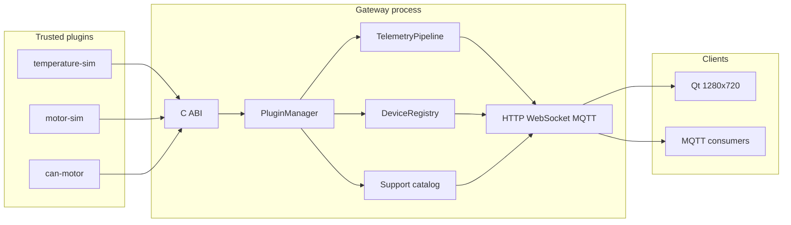

# Architecture

The gateway executable does not link a plugin, and the Qt screen does not link the gateway. `dlopen` loads a `.so` that exports `ogw_plugin_create` and `ogw_plugin_destroy`. Those functions are the only stable binary surface. Inside the process, C++ classes own the registry, the telemetry pipeline, the support catalog, and the HTTP and MQTT adapters. The Qt screen renders the sensor list and the enabled devices from `GET /api/v1/support` and the device API. Local Compose opens that window at 1280×720 on the host display. `OGW_UI=novnc` serves it in a browser. The later embedded-Linux image starts the same window fullscreen on the panel. Simulators stay inactive until a person enables them.

## Ownership

- The host copies every string before a host call returns. It does not keep pointers into a plugin.
- The host API enqueues work. It does not call back into the plugin on that stack.
- `stop` joins plugin threads before the host destroys the plugin object.
- Libraries stay mapped until the process exits. `dlclose` is intentionally not called.

## Threads

Plugin threads may publish readings at any time. Those readings enter a bounded queue of 4096. When the queue is full, the oldest reading is dropped and counted. A single consumer thread validates readings, updates current values, appends history, and fans out WebSocket and MQTT messages. Registry changes use a separate queue and are not dropped.

HTTP runs on a Boost.Asio pool. Handlers that activate a plugin or invoke a command wait on the consumer thread. They do not run plugin code on the socket thread. The MQTT thread also waits on that consumer when a command arrives.

## Support catalog

The running process publishes the exports it linked and the plugins it installed. REST, WebSocket, and MQTT are the exports. Each source entry carries its state, whether it is simulated, and the settings the plugin declared. `GET /api/v1/support` returns that document. A catalog change is also a `support` event on the live channel.

`PUT /api/v1/support/exports/{id}` and `PUT /api/v1/support/sources/{id}` change an advertised entry. Unknown ids are rejected. Bodies that carry a path, file, URL, or bytes are rejected. Health, support GET, and those PUTs stay available when REST telemetry or the WebSocket is turned off. An empty `OGW_MQTT_URL` still advertises MQTT; publishes are counted and the process still boots. Scan stays on the admin listener, which the cloud and Pi profiles leave off.

## Extension rule

A new device source is a new shared library. It registers devices with the capability document and publishes readings. `kind` is `measurement` or `command`. A measurement is what the dashboard prints. A command is what `POST /api/v1/devices/{id}/commands/{capability}` and the MQTT command topic invoke. Publishing a reading to a command capability is rejected.
