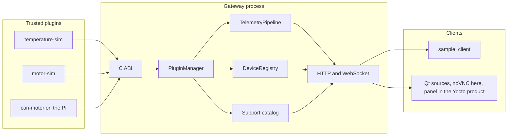

# Architecture

The gateway executable does not link a plugin, and neither client links the gateway. `dlopen` loads a `.so` that exports `ogw_plugin_create` and `ogw_plugin_destroy`. Those functions are the only stable binary surface. Inside the process, C++ classes own the registry, the telemetry pipeline, the support catalog, and the HTTP adapter. `sample_client` and the Qt screen only render what `GET /api/v1/support` and the device API advertise. This repository serves the Qt screen through noVNC. The Yocto image that puts the same sources on the 7-inch panel is a separate product. The gateway probes a real sensor first and uses the temperature simulator when none is connected.

## Ownership

- The host copies every string before a host call returns. It does not keep pointers into a plugin.
- The host API enqueues work. It does not call back into the plugin on that stack.
- `stop` joins plugin threads before the host destroys the plugin object.
- Libraries stay mapped until the process exits. `dlclose` is intentionally not called.

## Threads

Plugin threads may publish readings at any time. Those readings enter a bounded queue of 4096. When the queue is full, the oldest reading is dropped and counted. A single consumer thread validates readings, updates current values, appends history, and fans out WebSocket messages. Registry changes use a separate queue and are not dropped.

HTTP runs on a Boost.Asio pool. Handlers that activate a plugin wait on the consumer thread. They do not run plugin code on the socket thread.

## Support catalog

The running process publishes the exports it linked and the plugins it installed. REST and WebSocket are the exports in this build. MQTT and gRPC are absent until those listeners exist. Each source entry carries its state, whether it is simulated, and the settings the plugin declared. `GET /api/v1/support` returns that document. A catalog change is also a `support` event on the live channel.

`PUT /api/v1/support/exports/{id}` and `PUT /api/v1/support/sources/{id}` change an advertised entry. Unknown ids are rejected. Bodies that carry a path, file, URL, or bytes are rejected. Health, support GET, and those PUTs stay available when REST telemetry or the WebSocket is turned off. Scan stays on the admin listener, which the cloud and Pi profiles leave off.

## Extension rule

A new device source is a new shared library. It registers devices with the capability document and publishes readings. The dashboard chooses a card from `valueType` and the optional `presentation` hint. A numeric measurement does not become a command. `kind` must be `command` before the UI will even describe a command, and the MVP does not render a control for one.
